<a href="https://zishaan1911.github.io/">
  <picture>
    <source media="(prefers-color-scheme: dark)" srcset="assets/banner-dark.svg">
    
  </picture>
</a>

I build robots, simulators, and the occasional GPU. I run **[Seventh Axis](https://seventh-axis.vercel.app)**, a robotics company in Kuala Lumpur: you tell a robot arm what to do in English, Bahasa Malaysia or Mandarin, and it plans, checks and runs the program. I like projects where the physics has to be right.

---

### 🦾 Robots and hardware

| | |
|---|---|
| **[Seventh Axis](https://github.com/seventhaxisrobots/seventh-axis)** · [live](https://seventh-axis.vercel.app) | Program robot arms in plain language, in three languages. |
| **[tiny-gpu](https://github.com/zishaan1911/tiny-gpu)** | A triangle-rasterising GPU in Verilog on an iCE40 FPGA, driving VGA at 640×480. Comes with a routed 4-layer KiCad board. |
| **[OpenRover](https://github.com/zishaan1911/OpenRover)** | A rover autonomy stack built simulation-first: SLAM, planning, obstacle avoidance. Real hardware is optional. |
| **[VECTOR](https://github.com/zishaan1911/Vector-missile-interceptor)** | A closed-loop autonomy sandbox: noisy sensors, Bayesian estimation, guidance and control. |

### 🌌 Physics and simulation

| | |
|---|---|
| **[Kerrscope](https://github.com/zishaan1911/Kerrscope)** · [live](https://zishaan1911.github.io/Kerrscope/) | A real-time ray tracer for spinning black holes. It integrates light paths through Kerr spacetime in OpenGL. |
| **[spillway](https://github.com/zishaan1911/spillway)** | A C++20 puzzle game where you draw walls to steer a from-scratch SPH water simulation. |
| **[afterburner](https://github.com/zishaan1911/afterburner)** | A 3D fighter jet flight sim in Panda3D. |

### 🧠 AI and developer tools

| | |
|---|---|
| **[SmolGPT](https://github.com/zishaan1911/SmolGPT)** · [live](https://zishaan1911.github.io/SmolGPT/) | A small GPT I trained from scratch on TinyStories. It runs in your browser. |
| **[Helmsman](https://github.com/zishaan1911/Helmsman)** · [docs](https://zishaan1911.github.io/Helmsman/) | AI-assisted GitOps deployments, written in Go. |
| **[claude-parallel-agents](https://github.com/zishaan1911/claude-parallel-agents)** | A Claude Code skill: the orchestrator plans and reviews while cheaper models write the code in visible windows. |

### 📈 Markets and data

| | |
|---|---|
| **[pitwall](https://github.com/zishaan1911/pitwall)** · [live](https://zishaan1911.github.io/pitwall/) | Race engineering for real F1 races: tyre degradation models, strategy scoring, undercut audits. |
| **[Silica Index](https://github.com/zishaan1911/near-hackathon-2026)** · [live](https://silicaindex.vercel.app) | A live price index for GPU compute, with hourly futures that settle on NEAR. |
| **[GASX](https://github.com/zishaan1911/GASX)** · [live](https://gasx-ecru.vercel.app) | 🏆 Finalist at the MUBA Blockchain Hackathon 2026. |
| **[monte-carlo-engine](https://github.com/zishaan1911/monte-carlo-engine)** | Multi-asset Monte Carlo pricing and risk, accelerated with Numba. |

---

### 📄 Research

- [**How long is the graph of xⁿ?**](https://github.com/zishaan1911/arc-length-of-xn): logarithmic corner defects in arc length, with the paper and a numerical check.
- [**Hybrid SAT solver selection**](https://github.com/zishaan1911/hybrid-sat-selector): my final-year project at UTAR. It picks a SAT solver per instance by combining SATzilla features with GNN embeddings.
- Open-access papers:   

### 🧰 What I actually reach for

`C++` `Python` `TypeScript` `Go` `Rust` `Verilog` · `OpenGL` `raylib` `KiCad` · `React` `Next.js` `Laravel` · `Docker` `Vercel` `AWS`

Off the keyboard: rapid chess, peak . Ask me about black holes or F1 strategy.
